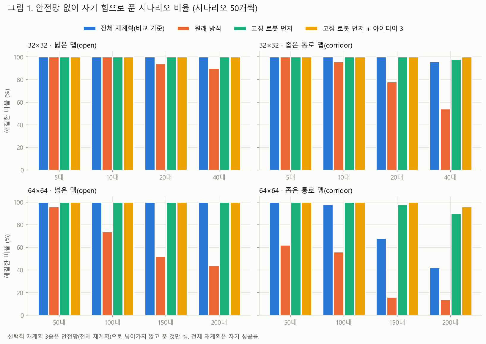
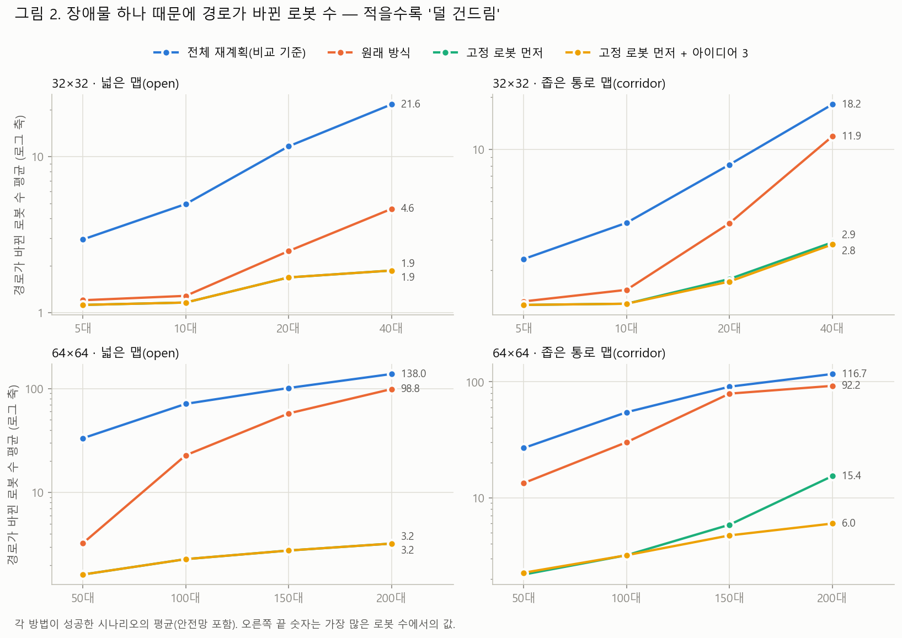
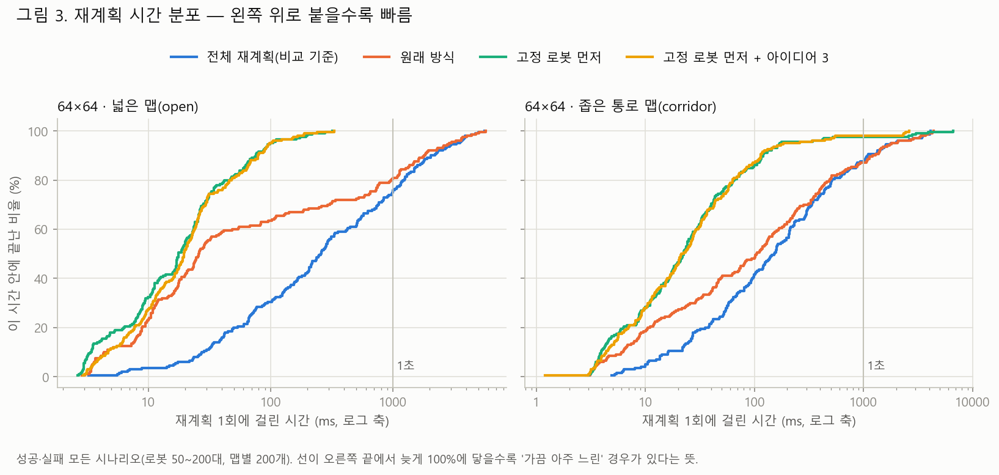
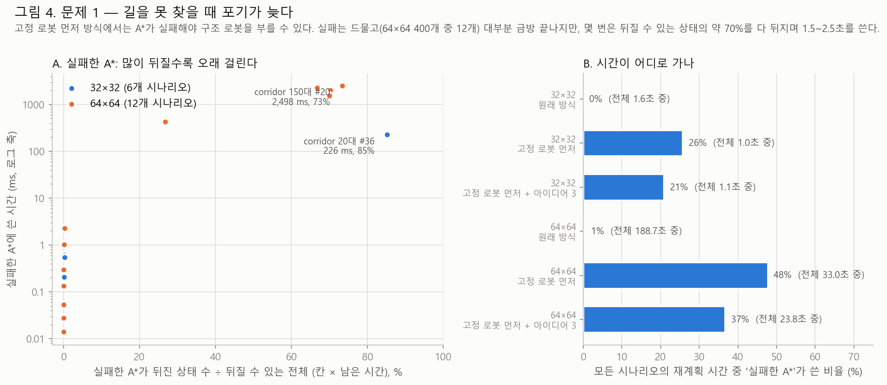
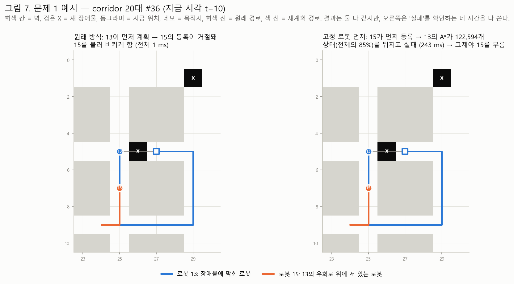
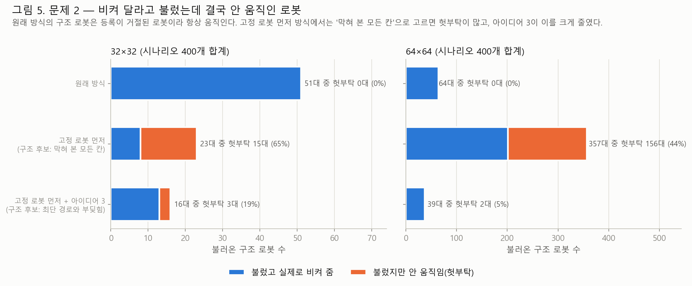
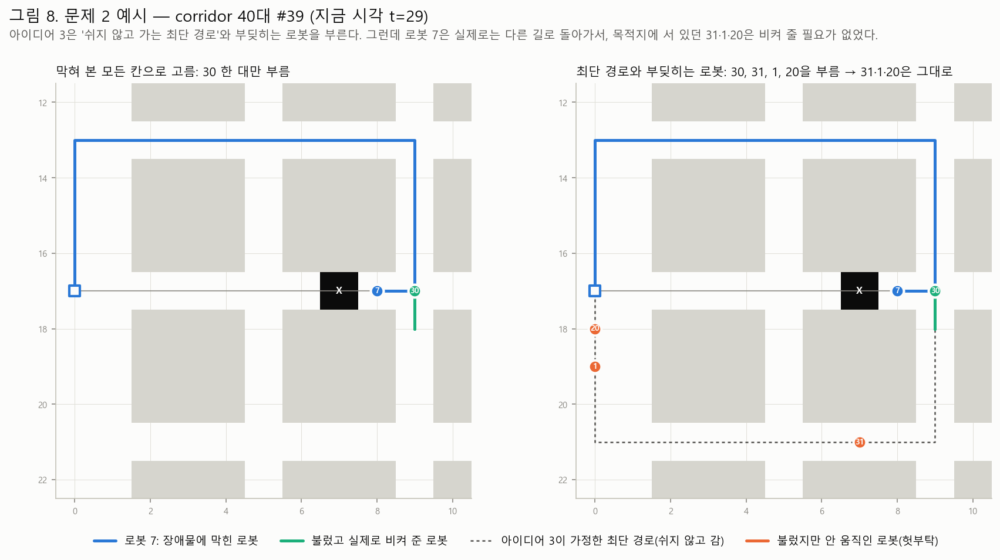
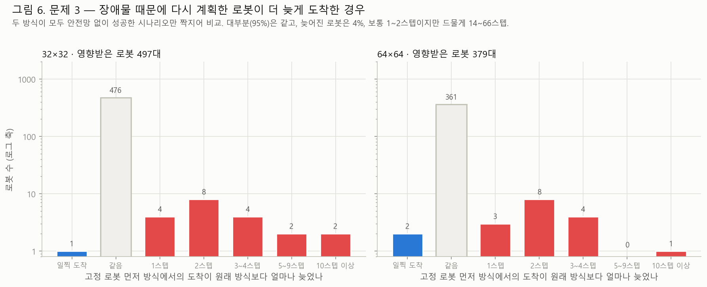
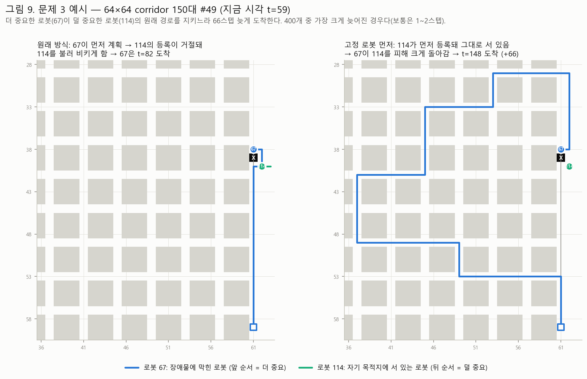

# 15. 기존 연구와 무엇이 다른가 + 남은 문제 3가지를 데이터로 보기

> 작성: 2026-09-13. 지금까지 모은 벤치마크 데이터를 그래프로 정리하고, 14장에서 말한 "남은 문제
> 3가지"가 실제로 얼마나, 어떤 모습으로 나오는지 측정했다. 그림은 `tools/plots_study/`에 있다.

> **⚠ 2026-11-17 정정**: 이 장의 그림 1~3과 수치는 A\*의 동점 처리가 "아무거나"이던 코드로 쟀다. 동점 규칙을
> 고정하니(18장 18.12) 64×64에서 전체 재계획의 "바뀐 로봇"이 75.5 → 7.7대, 성공이 354 → 393으로 바뀌었다.
> 예전 수치에는 동점 처리 때문에 생긴 쓸데없는 경로 바뀜이 많이 섞여 있었다. **"덜 건드림" 차이는 약 23배가 아니라
> 약 2배**다. 속도(약 10배)와 원래 방식 대비 안전망 없이 성공은 여전히 크다. 논문용 수치는 일정 9번에서 다시 잰다.

---

## 15.0 결론 먼저

| 질문 | 답 |
|---|---|
| 기존 연구와 다른가? | **"영향받은 로봇만 다시 계획한다"는 것 자체는 새롭지 않다.** 2026년 논문(Park 외, *Sensors*)이 공장 환경에서 거의 같은 일을 한다. 우리가 주장할 수 있는 건 **그게 실패했을 때 무엇을 하는가**다. 원인 로봇을 불러 넓히는 방법, 등록 순서가 실패의 99%를 만든다는 분석과 그 해결(fixed-first), 구조 후보 고르는 방법 비교. (15.1) |
| 문제 1: 포기가 늦다 | **드물지만 크다.** 64×64에서 A\*가 실패한 시나리오는 400개 중 12개뿐이다. 하지만 그중 4개는 뒤질 수 있는 상태의 약 70%를 다 뒤지며 1.5~2.5초씩 걸렸고, **전체 재계획 시간의 37%**가 여기에 쓰였다. (15.3) |
| 문제 2: 헛부탁 | **주로 옛 방식의 문제였다.** "막혀 본 모든 칸"으로 고르면 불러온 로봇의 44~65%가 헛부탁이었다. 아이디어 3에서는 5~19%로 줄었다. 남은 헛부탁은 "쉬지 않고 간다"는 가정 때문이다. (15.4) |
| 문제 3: 양보 | **드물고 대부분 작다.** 영향받은 로봇의 4%가 늦게 도착했고, 보통 1~2스텝이다. 하지만 최악은 **66스텝**이었다. 거의 모두 "원래 방식이라면 덜 중요한 로봇을 비키게 했을" 상황이다. (15.5) |
| 문제 4: 도착 후 상태 (2026-09-15 추가) | **모델 가정의 문제.** 도착한 로봇이 "작업 중"인지 "대기 중"인지 구분하지 않는다. 작업 중인 로봇도 구조 로봇으로 불려 끌려 나갈 수 있다. **작업 시간을 넣기로 결정(B).** 문제 3의 정의도 이것에 따라 바뀐다. (15.10) |

---

## 15.1 기존 연구와 무엇이 다른가 — 솔직하게

### 가장 가까운 연구

| 연구 | 하는 일 | 우리와 같은 점 | 우리와 다른 점 |
|---|---|---|---|
| **Park 외, "Robust MAPF for Obstacles and Environmental Changes in Factory Environments", *Sensors* 26(13):4139, 2026** | 장애물 때문에 영향받는 로봇(20초 안에 장애물 구간에 들어갈 로봇)만 골라 다시 계획한다. 안 건드린 로봇은 원래 경로를 유지한다. CBS 기반이고, 공장 100m×100m에 로봇 10~100대 | **"영향받은 로봇만 다시 계획 + 나머지는 그대로"라는 핵심 발상이 같다** | 선택적 재계획이 **실패했을 때 무엇을 하는지는 논문에 없다**(성공률 100%로 보고). 우리는 원인 로봇을 불러 넓히고(Tier), 안전망까지 둔다. 또 우리는 PP 기반 격자 모델, 그들은 CBS·연속 구간 모델 |
| PIEF (Švancara 외, 2019, Online MAPF) — 07장 | 다시 계획한 로봇의 새 경로가 다른 로봇과 부딪히면 그 로봇도 다시 계획 | 영향받은 로봇부터, 부딪히면 넓힘 | 새 경로가 **아예 안 나오는** 실패는 다루지 못한다(07장 7.2.1). 우리 Tier 1은 이 경우를 다룬다 |
| MAPF-LNS / LNS2 (Li 외, 2021·2022) | 일부 로봇만 골라 다시 계획하고 나머지 경로는 고정한다. 부분집합은 충돌·실패 기반 또는 무작위로 고른다 | "나머지 고정 + 일부만 다시 계획"(= fixed-first와 같은 구조), 충돌 기반 이웃 선택(= 아이디어 3-2와 비슷한 발상) | 목적이 다르다. LNS는 **처음 계획의 질 개선·충돌 수리**, 우리는 **실행 중 나타난 장애물에 대한 빠른 복구**. 다만 기법 자체는 겹치므로 **비교 실험이 필요하다** |
| Fioravantes 외, "When Agents Break Down in MAPF", 2025 | 고장 난 로봇 주변만 국소적으로 조정 | 전체를 다시 짜지 않고 영향받은 곳만 | 장애물이 아니라 **로봇 고장·지연**만 다룬다 |

### 그래서 주장할 수 있는 것 / 없는 것

- ❌ **"영향받은 로봇만 다시 계획한다"** — Park 2026, PIEF가 이미 한다.
- ❌ **"다른 로봇 경로를 고정하고 일부만 다시 계획한다"** — LNS 계열이 이미 한다.
- ✅ **"선택적 재계획이 실패했을 때, 원인 로봇만 결정론적으로 불러 넓히고, 그래도 안 되면 안전망"** —
  가장 가까운 Park 2026도 이 부분은 다루지 않는다.
- ✅ **"PP 기반 선택적 재계획은 등록 순서 때문에 실패하고(Tier 0 실패의 99%), 그 대부분은
  한 번에 하나씩만 드러나는 숨은 충돌(75%)"이라는 분석과 그 해결(fixed-first + 구조 로봇은 뒤에)** — 측정으로 뒷받침된다(11·12장).
- ✅ **"덜 건드림"(경로가 바뀐 로봇 수)을 성공률·시간과 함께 평가** — 그림 2.

**주의**: 이 판단은 짧은 검색으로 찾은 논문 기준이다. 논문으로 쓰기 전에 체계적인 문헌 조사가
필요하다. 특히 LNS2식 수리와 Park 2026식 방법을 **비교 기준으로 실제 구현해서** 비교해야 한다.
지금 비교 기준(전체 재계획)은 순서 하나짜리 PP라 약하다(10장 문제 4).

---

## 15.2 지금까지 데이터 한눈에

### 그림 1 — 안전망 없이 자기 힘으로 푼 비율



- 32×32에서는 네 방법 모두 대부분 푼다. 차이는 **좁은 통로·로봇이 많을 때** 벌어진다.
- 64×64 corridor 150~200대에서 원래 방식은 14~16%, 전체 재계획은 42~68%, **고정 로봇 먼저(+아이디어 3)는 90~100%**.

### 그림 2 — 경로가 바뀐 로봇 수 (적을수록 덜 건드림)



- 64×64 200대에서 전체 재계획은 평균 117~138대, 원래 방식은 92~99대를 바꾼다. 고정 로봇 먼저는
  3~15대, **아이디어 3을 더하면 3~6대**다.
- corridor 200대에서 고정 로봇 먼저(15.4대)와 아이디어 3(6.0대)의 차이가 바로 문제 2(헛부탁)가 줄어든 효과다.

### 그림 3 — 재계획 시간 분포 (64×64)



| 64×64, 모든 시나리오 | 전체 재계획 | 원래 방식 | 고정 로봇 먼저 | + 아이디어 3 |
|---|---|---|---|---|
| 시간 중앙값 | 206 ms | 49 ms | 20 ms | 20 ms |
| 95% 지점 | 2,770 ms | 2,604 ms | 161 ms | 150 ms |
| 가장 느린 경우 | 5,586 ms | 5,773 ms | 6,642 ms | 2,606 ms |

- 대부분은 고정 로봇 먼저 방식이 10배 가까이 빠르다. 그런데 **오른쪽 끝의 긴 꼬리**(몇 초 걸리는 몇 개)가
  남아 있다. 그게 문제 1이다.

---

## 15.3 문제 1 — 길을 못 찾을 때 포기가 늦다

### 얼마나 나오나



| | 32×32 | 64×64 |
|---|---|---|
| A\*가 한 번이라도 실패한 시나리오 (아이디어 3) | 400개 중 6개 | 400개 중 12개 |
| 그중 0.1초 넘게 걸린 것 | 1개 (226 ms) | 5개 (4개는 1.5~2.5초) |
| 느린 실패가 뒤진 상태 / 뒤질 수 있는 전체 | 85% | 67~73% |
| 전체 재계획 시간 중 실패한 A\*가 쓴 비율 | 21% | **37%** (고정 로봇 먼저만 쓰면 48%) |
| 원래 방식에서는 | 0% | 1% |

### 왜 생기나

고정 로봇 먼저 방식에서는 옛 경로를 먼저 다 등록하기 때문에, 막힌 로봇의 **A\*가 실패해야**
"누가 막았는지" 알고 구조 로봇을 부를 수 있다. 그런데 A\*는 "길이 없다"고 확신하려면 갈 수 있는
모든 (칸, 시각)을 다 확인해야 한다. 막힌 로봇이 갈 수 있는 영역이 **좁으면** 1 ms 안에 끝나지만,
**넓으면** 수십만 개 상태를 다 뒤진다.

원래 방식에서 이 문제가 거의 없는 이유는, 원래 방식의 실패가 대부분 "등록 거절"이라 A\*를 헛돌리지
않기 때문이다. 즉 **문제 1은 고정 로봇 먼저 방식이 치르는 대가**다.

13장의 도달성 검사는 이걸 막지 못한다. 이 로봇들은 "다른 로봇이 없으면 갈 수 있는" 로봇이기
때문이다. 막는 건 장애물이 아니라 로봇이다.

### 예시 — corridor 20대 #36



- 로봇 13 바로 앞에 새 장애물이 생겼다. 유일한 우회로에는 로봇 15가 자기 목적지에 서 있다.
- 원래 방식: 13이 먼저 계획해 15 자리를 지나가고 → 15의 등록이 거절돼 → 15를 불러 비키게 한다. 몇 ms.
- 고정 로봇 먼저: 15가 먼저 등록돼 있어 → 13의 A\*가 **122,594개 상태(전체 144,001개의 85%)**를
  다 뒤지고 실패(약 0.2초) → 그제야 15를 부른다. **결과 경로는 똑같다.** 실패를 확인하는 데만 시간을 썼다.

---

## 15.4 문제 2 — 비켜 달라고 불렀는데 결국 안 움직인 로봇

### 얼마나 나오나



"헛부탁" = 구조 로봇으로 불렀지만 결과적으로 움직임이 원래와 똑같은 로봇(결과를 보고 판정).

| 구조 후보 고르는 방법 | 32×32 | 64×64 |
|---|---|---|
| 원래 방식(등록 거절된 로봇) | 51대 중 0대 | 64대 중 0대 |
| 고정 로봇 먼저 + 막혀 본 모든 칸 | 23대 중 15대 (65%) | 357대 중 156대 (44%) |
| 고정 로봇 먼저 + 아이디어 3(최단 경로와 부딪힘) | 16대 중 3대 (19%) | 39대 중 2대 (5%) |

- 헛부탁은 **"막혀 본 모든 칸"으로 고를 때 가장 심했다.** 64×64 corridor 200대 #38에서는 156대를
  불렀는데 150대가 헛부탁이었다.
- 아이디어 3이 이걸 크게 줄였다. 남은 헛부탁은 시나리오 1~2개에서만 나온다.

### 예시 — corridor 40대 #39



- 로봇 7 앞에 장애물이 생겨 길을 못 찾는다.
- 아이디어 3은 "다른 로봇이 없을 때의 최단 경로"(점선)를 **쉬지 않고** 따라간다고 본다. 그 길은
  아래로 돌아가며 로봇 20, 1(목적지에 서 있음)과 31을 지나간다. 그래서 이 셋을 부른다.
- 하지만 실제 로봇 7은 **위쪽 길**로 돌아갔다. 20·1·31은 비켜 줄 필요가 없었다.
- 짐작이 맞았다. "하나의 최단 경로, 쉬지 않는 일정"만 보고 고르기 때문이다.

참고: 13장에서 본 "아이디어 3을 켜니 부른 로봇이 2→6대로 늘고 비용이 늘었다"(corridor 40대 #9)는
경우는 불린 로봇들이 **실제로 움직였다.** 그래서 이 표의 헛부탁에는 안 잡힌다. 헛부탁은 아니지만
"다른 로봇을 불러서 더 비싸진" 별개의 부작용이다.

---

## 15.5 문제 3 — 다시 계획한 로봇이 더 늦게 도착한다

### 얼마나 나오나



두 방식이 모두 안전망 없이 성공한 시나리오에서, 영향받은 로봇의 도착 시각을 로봇별로 비교했다.

| | 32×32 (497대) | 64×64 (379대) |
|---|---|---|
| 같음 | 476대 (96%) | 361대 (95%) |
| 고정 로봇 먼저가 더 늦음 | 20대 (4%) | 16대 (4%) |
| 늦어진 정도 | 중앙값 2스텝, 최대 14스텝 | 중앙값 2스텝, **최대 66스텝** |
| 고정 로봇 먼저가 더 빠름 | 1대 | 2대 |
| 늦어진 경우 중 "원래 방식이 구조 로봇을 불렀던" 시나리오 | 20개 중 20개 | 16개 중 15개 |

마지막 줄이 핵심이다. 늦어진 거의 모든 경우가 **원래 방식이라면 다른 로봇을 비키게 했을 상황**이다.
고정 로봇 먼저에서는 그 로봇의 옛 경로를 지키느라 영향받은 로봇이 돌아간다.

### 예시 — 64×64 corridor 150대 #49 (가장 크게 늦어진 경우)



- 로봇 67(앞 순서 = 더 중요) 바로 앞에 장애물이 생겼다. 가장 짧은 우회로에는 로봇 114(뒤 순서 =
  덜 중요)가 자기 목적지에 서 있다.
- 원래 방식: 67이 먼저 계획해 114 자리를 지나가고 → 114를 불러 비키게 한다 → 67은 t=82에 도착.
- 고정 로봇 먼저: 114의 옛 경로(계속 서 있음)가 먼저 등록돼 → 67이 114를 피해 크게 돌아간다 →
  **t=148 도착(+66스텝)**. 67의 우회로를 막은 건 114 하나뿐이었다(직접 확인).

### 또 하나 — 간접적으로 퍼지는 경우 (open 40대 #40)

로봇 33이 14스텝 늦어졌다. 따라가 보니 한 단계가 아니었다.
1. 로봇 8(더 중요)이 17(덜 중요)의 옛 경로를 피해 다른 길로 갔다. ← 진짜 양보
2. 그 때문에 장부가 달라져, 로봇 15의 A\*가 **길이가 같은 다른 길**을 골랐다. 15의 원래 길은 여전히
   쓸 수 있었는데, 같은 비용인 경로 중 무엇을 고를지(tie-break)가 바뀐 것이다.
3. 15의 새 길이 33의 길과 겹쳐 33이 돌아갔다.

그래서 문제 3은 "양보한 로봇 자신"뿐 아니라 **다른 로봇에게 번져서** 나타날 수도 있다.

---

## 15.6 이전 설명에서 고친 것

| 이전 설명 | 측정 후 |
|---|---|
| "길이 없을 때는 모든 칸 × 모든 시간을 다 확인한다" | **넓은 영역에서 막혔을 때만** 그렇다. 실패 대부분은 1 ms 안에 끝난다 |
| "가끔 필요 없는 로봇에게 부탁한다"를 아이디어 3의 문제로 설명 | 헛부탁은 **옛 방식("막혀 본 모든 칸")에서 훨씬 심했다**(44~65%). 아이디어 3은 5~19% |
| "중요한 로봇이 양보해서 조금 늦는다" | 대부분 1~2스텝이 맞다. 하지만 **최악 66스텝**이 있고, 다른 로봇에게 **간접적으로 번지는** 경우도 있다 |

---

## 15.7 어떻게 쟀나

- 임시 도구로 벤치마크와 **같은 시드**의 시나리오를 다시 만들었다. 세 설정(원래 / 고정 로봇 먼저 /
  +아이디어 3)으로 선택적 재계획을 돌리며 다음을 기록했다.
  - 모든 A\* 호출의 시간, 뒤진 상태 수, 성공 여부
  - 구조 로봇마다 실제로 움직였는지
  - 영향받은 로봇마다 도착 시각
- 측정 코드는 확인 후 **삭제**했다(테스트 52개 통과). 모은 데이터는 남겨 두었다.
  - `tools/results/problems_default.csv`, `tools/results/problems_large.csv` — 시나리오 × 설정마다 한 줄
  - `tools/results/examples/*.json` — 예시 시나리오 4개의 전체 경로와 A\* 호출 기록
- 그림: `python tools/plot_overview.py`(그림 1~3), `python tools/plot_problems.py`(그림 4~9).
- 시간은 컴퓨터 부하에 따라 흔들린다. 그림 7의 A\* 실패는 한가할 때 3번 재서 190~243 ms였다(다른
  실험과 동시에 돌렸을 때는 882 ms까지 나왔다).

---

## 15.8 다음에 무엇부터 고칠까

| 순서 | 문제 | 제안 | 이유 |
|---|---|---|---|
| 1 | 문제 1 | **A\* 휴리스틱을 "실제 최단거리"로 바꾸기**: 목적지에서 BFS를 한 번 돌려 각 칸의 실제 거리를 쓴다(HCA\* 방식). "남은 시간 안에 못 가는 상태"와 "목적지에 못 가는 칸"을 미리 잘라낸다 | 전체 시간의 37%를 차지하는 가장 큰 병목이다. 결과(경로)는 그대로고 속도만 바뀌어 검증하기 쉽다 |
| 2 | 문제 3 | **"우회 비용이 크면 비켜 달라고 하기"**: 고정 로봇을 피한 우회가 원래 대비 N스텝 넘게 늘면, 그 경로를 막은 고정 로봇을 구조 로봇으로 불러 비교한다 | 대부분은 문제없고 가끔 크게(66스텝) 나빠지므로, 나쁜 경우만 골라 고치는 규칙이 맞다 |
| 3 | 문제 2 | 대기를 허용한 경로로 부딪힘을 보거나, 두 방법의 후보 중 적은 쪽을 쓰기 | 이미 5~19%로 작다. 우선순위는 낮다 |
| 4 | 비교 기준 | LNS2식 수리, Park 2026식 방법을 비교 기준으로 구현 | 15.1의 차별점을 논문에서 방어하려면 필요하다 |

---

## 15.9 스스로 확인하는 질문

1. Park 2026과 우리 방법이 같은 점 하나, 다른 점 하나는? (→ 15.1)
2. 원래 방식에서는 문제 1이 거의 없고, 고정 로봇 먼저 방식에서만 생기는 이유는? (→ 15.3)
3. 도달성 검사(13장)가 문제 1을 막지 못하는 이유는? (→ 15.3)
4. "헛부탁"은 어떻게 판정했고, 어느 방법에서 가장 심했나? (→ 15.4)
5. 그림 8에서 아이디어 3이 20·1·31을 부른 이유는? (→ 15.4)
6. 늦어진 로봇 대부분이 "원래 방식이라면 구조 로봇을 불렀을 상황"이라는 게 무슨 뜻인가? (→ 15.5)
7. open 40대 #40에서 33이 늦어진 과정은 왜 "양보" 하나로 설명되지 않나? (→ 15.5)

---

## 15.10 문제 4 — 도착한 로봇은 작업 중인가, 대기 중인가 (2026-09-15 추가)

### 무엇이 문제인가

지금 코드는 도착한 로봇을 두 가지로 다르게 다룬다.

- **다른 로봇이 길을 찾을 때**: 도착한 로봇은 Tail Reservation 때문에 `max_timestep`까지 **안 움직이는 벽**이다.
- **구조 로봇으로 불릴 때**: 같은 로봇이 **자유롭게 움직인다**(16장의 K는 비켰다가 돌아온다).

즉 "도착 = 할 일 없이 주차 중, 비켜도 됨"이라는 가정이다(일반적인 one-shot MAPF의 가정). 하지만 실제
물류 현장에서 도착한 로봇은 **짐을 싣거나 내리는 작업 중**일 수 있고, 작업 도중 끌려 나가면 안 된다.

### 결정 (2026-09-15): 작업 시간을 모델에 넣는다

```
도착 ──[ 작업 중: 절대 못 비킴 ]──[ 작업 끝, 대기: 비켜도 됨 ]──
       t_도착 ~ t_도착 + 작업 시간      그 이후
```

예상되는 코드 변화(설계 전, 확정 아님):
- `Agent`에 작업 시간을 추가한다.
- A\* 도착 판정: 도착 후 **작업 시간 동안** 목적지를 쓸 수 있어야 도착으로 인정한다.
- 구조 후보: **작업 중인 로봇은 부르지 않는다**(장애물처럼 취급).
- 예약 장부: "작업 중" 예약과 "대기 중" 예약을 구분한다.
- 벤치마크: 작업 시간을 어떻게 줄지 정한다.
- 비교 대상(전체 재계획, Park 2026식, LNS2식)도 **같은 규칙**을 지키게 구현해야 공정하다.

### 문제 3의 정의가 바뀐다

그림 9에서 114가 **작업 중**이었다면 67이 돌아간 것(+66)은 **올바른 동작**이고, 114를 비키게 한 원래
방식이 틀린 것이다. 114가 **대기 중**이었다면 지금처럼 문제 3이 맞다. 그래서 문제 3은 "**대기 중인**
로봇을 피해 크게 돌아가는 것"으로 다시 정의해야 한다.

### 문헌 확인 (짧은 검색, 2026-09-15)

| 연구 | 작업 시간 | 예기치 않은 장애물 재계획 | 실패 시 처리 |
|---|---|---|---|
| Park 외 2026 (*Sensors*) | **없음.** lifelong, 작업을 마치면 바로 새 작업 | 있음(정적: 박스 / 동적: 사람·지게차), 영향받은 로봇만 재계획 | **없음**(성공률 100%만 보고) |
| MCPF with Heterogeneous Task Duration (Zhang 외, 2023/24) | **있음**(로봇·목표마다 다른 작업 시간) | 없음(오프라인 계획) | — |
| MAPF for Schedule Constrained Automation (SoCS) | **있음**(목적지 도착 후 처리 시간) | 지연 시 재계획 언급, 장애물 아님 | — |
| FlexSIPP (Hanou 외, SoCS 2026) | 언급 없음 | 장애물 아님, **로봇 지연** 시 지연된 로봇 하나 재계획 | — |
| MAPD 계열 (Ma 외 2017 등), RHCR (Li 외 2021) | 창고 lifelong. 작업 시간은 보통 0(도착 = 완료) | 장애물 아님, 새 목표 받을 때 재계획 | — |
| Jiang 외 2024, "Scaling Lifelong MAPF to More Realistic Settings" | 과제 목록에 **없음** | 지도 변화(도로 폐쇄 등)는 과제로 언급 | — |
| Nagai & Okumura 2026, "From Gridworlds to Warehouses" | 없음 | 없음(회전·가감속 등 운동 제약만) | — |

**정리**
- **"작업 시간" 자체는 새롭지 않다.** 오프라인 계획(MCPF, 스케줄 제약 MAPF)에서는 이미 다룬다.
- **"기존 MAPF는 물류 현장을 고려하지 않았다"는 주장은 쓰면 안 된다.** 창고를 목표로 한 연구가 많다(RHCR, MAPD, Park 2026 등).
- 짧은 검색에서 **찾지 못한 조합**: "실행 중 예기치 않은 장애물 → 영향받은 로봇만 재계획 → 실패하면
  원인 로봇을 불러 비키게 함 → 이때 **작업 중인 로봇은 부르지 않음**". 차별점을 이렇게 **구체적인 조합**으로
  말하는 것이 안전하다. 예: "기존 선택적 재계획 연구는 도착한 로봇의 작업 상태를 구분하지 않거나(Park 2026),
  작업 시간을 오프라인 계획에서만 다룬다."
- **주의**: 짧은 검색 결과다. 논문을 쓰기 전에 체계적인 문헌 조사가 필요하다(특히 MAPD의 작업 시간 변형,
  온라인 MAPF + 처리 시간).

---

## 참고 문헌

- S. Park, J. Lee, G. Park, I. Cho, S. Moon, W. Chung, "Robust Multi-Agent Path Finding Method for
  Obstacles and Environmental Changes in Factory Environments," *Sensors* 26(13):4139, 2026.
  <https://doi.org/10.3390/s26134139> · <https://pmc.ncbi.nlm.nih.gov/articles/PMC13363869/>
- F. Fioravantes, D. Knop, N. Melissinos, M. Opler, "When Agents Break Down in Multiagent Path Finding,"
  arXiv:2508.03777, 2025. <https://arxiv.org/abs/2508.03777>
- G. Fejziaj, S. Hassona, W. Marszalek, "On dynamic multi-agent pathfinding methods: review, simulations
  and modifications," arXiv:2606.03735, 2026. <https://arxiv.org/abs/2606.03735>
- J. Li et al., "Anytime Multi-Agent Path Finding via Large Neighborhood Search," IJCAI 2021.
  <https://www.ijcai.org/proceedings/2021/0568.pdf>
- J. Li et al., "MAPF-LNS2: Fast Repairing for Multi-Agent Path Finding via Large Neighborhood Search," AAAI 2022.
- J. Švancara et al., "Online Multi-Agent Pathfinding," AAAI 2019 (07장).
- Y. Zhang, X. Wu, H. Wang, Z. Ren, "Multi-Agent Combinatorial Path Finding with Heterogeneous Task Duration,"
  arXiv:2311.15330, 2023. <https://arxiv.org/abs/2311.15330>
- "Multi-Agent Path Finding for Schedule Constrained Automation," SoCS.
  <https://ojs.aaai.org/index.php/SOCS/article/download/36007/38162/40090>
- I. Hanou, E. Kemmeren, D. W. Thomas, M. de Weerdt, "Precomputing Multi-Agent Path Replanning Using Temporal
  Flexibility," SoCS 2026. <https://arxiv.org/abs/2601.04884>
- H. Ma, J. Li, T. K. S. Kumar, S. Koenig, "Lifelong Multi-Agent Path Finding for Online Pickup and Delivery Tasks,"
  AAMAS 2017. <https://arxiv.org/abs/1705.10868>
- J. Li et al., "Lifelong Multi-Agent Path Finding in Large-Scale Warehouses," AAAI 2021. <https://arxiv.org/abs/2005.07371>
- H. Jiang, Y. Zhang, R. Veerapaneni, J. Li, "Scaling Lifelong Multi-Agent Path Finding to More Realistic Settings:
  Research Challenges and Opportunities," arXiv:2404.16162, 2024. <https://arxiv.org/abs/2404.16162>
- Nagai, Okumura, "From Gridworlds to Warehouses: Adapting Lightweight One-shot Multi-Agent Pathfinding for AGVs,"
  2026. <https://arxiv.org/abs/2605.15799>
