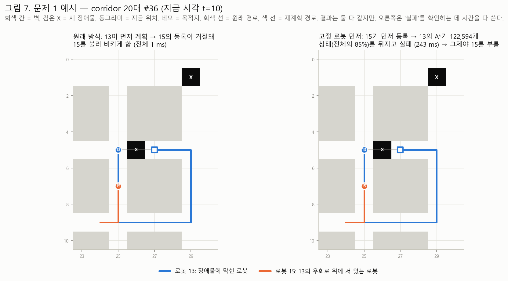

# 18. 문제 1 설계 — "장부가 굳는 시각" 이후는 한 번만 보기

> 작성: 2026-11-17. 15장의 **문제 1**(길이 없을 때 A\*가 포기하기까지 너무 오래 걸림)을 고치기 위한 설계
> 문서다. 코드를 쓰기 **전에** 정리한다. 16장(코드 실행 순서)과 17장(작업 시간)을 읽었다고 가정한다.

---

## 18.0 한 장 요약

| 질문 | 답 |
|---|---|
| 무엇이 문제인가? | 길이 없을 때 A\*는 **가능한 모든 (칸, 시각)**을 다 확인한 뒤에야 포기한다. 시각은 지금부터 `max_timestep`(256)까지라, 시각 층이 수백 개다. 64×64에서 몇 개 시나리오가 1.5~2.5초씩 걸려 **전체 재계획 시간의 37%**를 차지했다 |
| 핵심 관찰 | 다른 로봇들이 전부 도착하고 나면 **장부가 더 이상 안 바뀐다**(굳는다). 그 뒤의 시각들은 **똑같은 그림의 반복**이다. 그림 7에서는 t=41에 굳었는데, A\*는 t=42~256의 215개 층을 쓸데없이 다 확인했다 |
| 해결 | 장부가 굳은 뒤로는 **같은 칸을 한 번만** 확인한다. 굳은 뒤에는 "일찍 도착"이 "늦게 도착"보다 항상 낫거나 같기 때문이다 |
| 결과가 바뀌나? | **안 바뀐다**(18.4). 단, 그걸 정확히 확인하려면 먼저 A\*의 **동점 처리를 고정**해야 한다(18.5). 동점 처리를 고정하는 순간 결과가 **한 번** 바뀐다 |
| 15장의 원래 제안은? | "실제 거리 휴리스틱"은 **이 문제(실패가 느림)를 직접 풀지 못하고**, 결과도 바꾼다. 15장의 "결과는 그대로"라는 말은 틀렸다(18.7) |

---

## 18.1 문제 다시 보기 — 그림 7



로봇 13은 (25,5)에 있고 목적지는 (27,5)다. 바로 옆 (26,5)에 장애물이 생겼다. 위로 돌아가는 길은 다른 장애물
(29,1)에 막혀 있고, 남은 아래 길 (25,7)에는 **로봇 15가 자기 목적지에 서 있다.**

고정 먼저 방식에서는 15의 옛 경로(목적지에 영원히 머묾)가 먼저 장부에 적힌다. 그래서 13의 A\*는 길을 못 찾는다.

### A\*가 "길이 없다"고 확신하는 방법

시공간 A\*가 다루는 것은 칸이 아니라 **(칸, 시각)** 쌍이다. "길이 없다"고 말하려면, 갈 수 있는 모든 (칸, 시각)을
다 확인해서 그중 어디서도 목적지에 갈 수 없다는 걸 보여야 한다.

```
시각 층:   t=10   t=11   t=12   ...   t=41   t=42   ...   t=256
           [맵]   [맵]   [맵]   ...   [맵]   [맵]   ...   [맵]      ← 층마다 빈 칸 583개
```

- 층 수: 10부터 256까지 **247개**
- 확인할 수 있는 상태: 583칸 × 247층 = **144,001개**
- 실제로 확인한 상태: **122,594개(85%)**, 약 0.2초

### 그런데 t=41 이후는 전부 같은 그림이다

저장해 둔 데이터(`tools/results/examples/default_corridor_20_36.json`)를 보면, 다른 로봇 19대는 **늦어도 t=41에 전부
목적지에 도착**한다. 도착한 로봇은 그 자리에 끝까지 머문다(Tail). 장애물도 생긴 뒤로는 그대로다.

그러니 **t=41부터 장부는 한 칸도 안 바뀐다.** t=41, t=42, …, t=256의 층은 **똑같은 그림**이다.

```
t=10 ~ t=41:   층마다 그림이 다름 (로봇들이 움직이는 중)        → 다 봐야 함
t=41 ~ t=256:  모든 층이 같은 그림 (아무도 안 움직임)          → 한 장만 보면 됨
```

A\*는 이걸 몰라서 t=42~256의 **215개 층**을 다 확인했다. 비유하면, **영상이 t=41에서 멈춰서 정지 화면이 계속되는데,
끝날 때까지 한 장면씩 다 들여다본 것**이다.

---

## 18.2 해결 — 굳은 뒤로는 같은 칸을 한 번만

**장부가 굳는 시각**을 `Ts`라고 하자. 그림 7에서는 `Ts = 41`이다.

지금 A\*는 "이 (칸, 시각)을 이미 확인했나?"를 `(x, y, t)` 그대로 기억한다. 바꾸는 것은 딱 하나다.

```
지금:     (x, y, t)를 기억
앞으로:   t < Ts  이면 (x, y, t)를 기억        ← 그대로
          t >= Ts 이면 (x, y, Ts)로 묶어서 기억  ← 굳은 뒤로는 시각을 구분하지 않음
```

그러면 굳은 뒤로는 **같은 칸을 한 번만** 확인한다. 그림 7에서 확인할 상태의 최대치는 이렇게 줄어든다.

| | 시각 층 | 최대 상태 수 |
|---|---|---|
| 지금 | t=10~256, 247층 | 583 × 247 = 144,001 |
| 바꾼 뒤 | t=10~41의 32층 + 굳은 층 1장 | 583 × 33 = 19,239 이하 |

최대치 기준으로 약 **7분의 1**이다. 실제로 얼마나 줄어드는지는 구현한 뒤 잰다(18.9).

이 방법의 좋은 성질이 하나 더 있다. 지금은 `max_timestep`을 키우면(예: 256 → 1000) 실패 비용도 그만큼 커진다.
바꾼 뒤에는 굳은 뒤의 층을 한 장으로 묶으므로, **실패 비용이 시간 한도와 거의 상관없어진다.**

---

## 18.3 장부는 언제 굳나 — `Ts` 계산

장부에 무언가를 적는 곳은 세 군데뿐이다. 각각 "언제부터 더 이상 안 바뀌는지"가 정해져 있다.

| 적는 곳 | 무엇을 적나 | 이 예약이 굳는 시각 |
|---|---|---|
| `register_path` | 로봇 경로 + 도착 후 `max_timestep`까지 목적지(Tail) | **경로 끝 시각**. 그 뒤로는 목적지에 계속 있으니 안 바뀜. 이동(edge) 예약도 경로 끝 전에서 끝남 |
| `reserve_new_obstacles` | 장애물 칸을 지금부터 `max_timestep`까지 | **지금 시각**(current_time) |
| `reserve_ongoing_tasks` (17장) | 작업 중인 로봇의 남은 작업 칸, 지금 ~ 작업 끝 | **작업 끝 + 1**. 작업 끝 다음 시각에 그 표시가 사라지므로(장부가 한 번 바뀜) 그다음부터 굳음 |

`Ts`는 이 값들 중 **가장 큰 값**이다. 플래너가 장부에 적을 때마다 `Ts`를 키운다.

**`Ts`를 실제보다 크게 잡는 건 안전하다**(묶는 층이 줄어들 뿐 결과는 같다). **작게 잡으면 틀린다**(아직 바뀌는
층을 같은 그림으로 착각한다). 그래서 기본값은 "모름"이고, 모르면 지금처럼 동작한다. 플래너처럼 장부를 처음부터
끝까지 직접 채우는 쪽만 `Ts`를 알려 준다.

### 어디에 저장하나

`Ts`는 "이 장부가 언제부터 안 바뀌나"라는 **장부의 성질**이다. 그래서 `ReservationTable`에 둔다.

```cpp
// ReservationTable에 추가
std::optional<int> settled_from() const;   // 이 시각부터 예약이 안 바뀐다. 모르면 nullopt
void mark_settled_from(int t);             // "적어도 t 전까지는 바뀔 수 있다"를 알린다 → max로 키움
// clear()하면 다시 "모름"
```

A\*는 장부에 `Ts`가 있으면 쓰고, 없으면(직접 `reserve()`로 채운 A\* 테스트들) 지금과 똑같이 동작한다.

---

## 18.4 왜 결과가 안 바뀌나

**굳은 뒤에는 같은 칸에 "일찍" 도착한 쪽이 "늦게" 도착한 쪽보다 항상 낫거나 같다.**

로봇이 (x, y)에 t1에 도착한 경우와 t2(> t1)에 도착한 경우를 비교하자. 둘 다 `Ts` 이후다.

- 굳은 뒤에는 장부가 안 바뀐다. (x, y)가 t1에 비어 있었으면 그 뒤로도 계속 비어 있다.
- 그러니 t1에 도착한 로봇은 **(x, y)에서 t2까지 기다렸다가**, t2에 도착한 로봇이 할 수 있는 모든 걸 똑같이 할 수 있다.
- 반대로 t1에 도착한 로봇은 기다리지 않고 **더 일찍** 움직일 수도 있다.

그래서 t2에 도착한 쪽을 따로 확인해 봐야 새로 찾을 길이 없다. A\*는 같은 칸이면 일찍 도착한 쪽(작은 f)을 먼저
꺼내므로, 묶어서 기억해도 **먼저 꺼낸 일찍 도착한 쪽만 남고 늦은 쪽은 버려진다.**

### 굳기 전에는 왜 이게 안 되나 (비교)

```
굳기 전:  t50 로봇 R이 B에 도착 → t51 다른 로봇 Q가 B를 지나감 → R은 B에서 기다릴 수 없어 비켜야 함
굳은 뒤:  t50 로봇 R이 B에 도착 → t51, t52, … 아무도 안 움직임 → R은 B에서 얼마든지 기다릴 수 있음
```

| | 굳기 전 | 굳은 뒤 |
|---|---|---|
| B에 일찍 온 로봇이 B에서 기다릴 수 있나 | 누가 지나가면 **못 기다림** | **항상 기다릴 수 있음** |
| "B에 t51"이 "B에 t50"에 포함되나 | 아님 → 시각마다 따로 확인 | 포함 → 처음 도착한 시각 한 번만 확인 |

비유: 굳기 전은 **시간에 따라 문이 열리고 닫히는 미로**라서 같은 방이라도 들어온 시각마다 열려 있는 문이 다르다.
굳은 뒤는 **문이 전부 고정된 미로**라서, 1시에 방에 들어온 사람은 2시까지 그 방에 있을 수도 있으니 2시에 들어온
경우가 이미 포함된다.

이것은 성공할 때(경로)와 실패할 때(누가 막았나) 둘 다 같다.

| 결과 | 바뀌나? | 이유 |
|---|---|---|
| 찾은 경로 | 안 바뀜 | 가장 빠른 도착 경로는 늦게 도착한 쪽을 거치지 않는다 |
| 막힌 칸 목록의 **주인들**(구조 로봇 후보) | 안 바뀜 | 늦게 도착한 쪽이 부딪힌 칸은 일찍 도착한 쪽도 (같은 그림이라) 먼저 부딪혔다. 목록이 짧아질 뿐 주인과 그 순서는 같다 |
| 확인한 상태 수, 시간 | **줄어듦** | 이게 목적 |

---

## 18.5 함정 — A\*의 동점 처리

위 18.4는 "A\*가 꺼내는 순서가 같다면"이 전제다. 그런데 지금 A\*는 **f가 같은 노드끼리는 아무렇게나** 꺼낸다.

```cpp
// 지금 비교 규칙: f만 본다
bool operator()(a, b) { return a->f() > b->f(); }
```

f가 같을 때 무엇이 먼저 나올지는 `std::priority_queue` 내부 배열 모양에 달려 있다. 그리고 그 모양은 **무엇을 넣고
뺐는지 전부**에 따라 달라진다. 18.2처럼 늦게 도착한 노드를 안 넣기 시작하면 배열 모양이 바뀌고, 길이가 똑같은
경로들 중 **다른 것**이 뽑힐 수 있다. 그 로봇의 도착 시각은 같지만, 뒤 순서 로봇들이 보는 장부가 달라져서 전체
결과가 조금 달라질 수 있다(15장 open 40대 #40에서 본 것과 같은 현상).

그러면 "결과가 정말 안 바뀌었나"를 1-8단계처럼 **칸 하나하나 비교**로 확인할 수 없다.

### 해결: 동점 처리를 규칙으로 고정

```
1순위: f가 작은 것
2순위: f가 같으면 g가 큰 것   (목적지에 더 가까이 간 쪽 = 남은 거리가 짧은 쪽. A*에서 흔히 쓰는 규칙이고
                              성공할 때 확인하는 상태도 줄어든다)
3순위: 그것도 같으면 먼저 넣은 것   (넣은 순서 번호)
```

이렇게 하면 꺼내는 순서가 **배열 모양과 상관없이** 정해진다. 늦게 도착한 노드를 빼도 나머지 노드끼리의 순서는
그대로다.

### 그래서 두 단계로 나눈다

| 단계 | 하는 것 | 결과 |
|---|---|---|
| **2-1** | 동점 처리 규칙 고정 | 결과가 **한 번 바뀐다**(길이가 같은 다른 경로가 뽑힐 수 있음). 이걸 **새 기준선**으로 저장 |
| **2-2** | 굳은 뒤 묶기 | 결과가 2-1과 **완전히 같아야** 한다(1-8단계처럼 칸마다 비교). 시간만 줄어야 한다 |

2-1에서 결과가 바뀌는 건 "더 나빠져서"가 아니라 "동점끼리 고르는 방법이 바뀌어서"다. 그래도 바뀐 정도는 숫자로
보고한다(성공률, 비용 합, 바뀐 로봇 수가 얼마나 달라졌나).

---

## 18.6 다른 후보들

| 후보 | 하는 것 | 그림 7에서 | 결과 | 판단 |
|---|---|---|---|---|
| **A. 굳은 뒤 묶기 (이 문서)** | Ts 이후 같은 칸 한 번만 | 247층 → 33층 이하 | 안 바뀜(18.4) | **먼저 한다** |
| B. 갇힘 판정 | "지금부터 끝까지 막힌 칸"(목적지에 이미 서 있는 로봇 등)을 벽으로 보고 목적지에서 BFS. 시작 칸이 목적지와 끊겨 있으면 바로 실패 | 15가 벽이 되어 **즉시 실패** | 실패 때 "막혀 본 칸" 목록이 거의 비어서, 원래 방식(막혀 본 모든 칸)의 구조 후보가 사라진다 | A 후 측정해서, 여전히 느린 경우가 많으면 검토 |
| C. 실제 거리 휴리스틱 (15장 제안) | 맨해튼 거리 대신 BFS 실제 거리 | 실패 때 확인하는 상태가 거의 안 줄어듦(18.7) | 동점이 바뀌어 **결과가 바뀜** | 이번에는 안 함 |

---

## 18.7 15장 제안 정정

15장 15.8은 "A\* 휴리스틱을 실제 최단거리로 바꾸면 … 결과(경로)는 그대로고 속도만 바뀌어 검증하기 쉽다"고 했다.
두 가지가 틀렸다.

1. **실패가 빨라지지 않는다.** 휴리스틱은 "어느 상태를 **먼저** 볼지"를 정할 뿐이다. 길이 없으면 결국 **전부** 봐야
   포기하므로, 보는 순서가 바뀌어도 보는 양은 거의 같다. 줄어드는 건 "남은 시간 안에 목적지에 못 닿는 상태를
   잘라내는" 부분뿐인데, 그건 시간 한도 근처의 층만 깎는다.
2. **결과가 바뀔 수 있다.** 휴리스틱이 바뀌면 f가 바뀌고, 동점끼리 고르는 결과가 바뀐다(18.5).

실제 거리 휴리스틱은 **성공하는 탐색**을 빠르게 하는 데는 쓸모가 있다(벽을 돌아가야 하는 corridor 맵에서 특히).
필요하면 A 다음에 따로 검토한다.

---

## 18.8 바뀌는 곳

| 파일 | 바뀌는 것 | 단계 |
|---|---|---|
| `core/src/space_time_astar.cpp` | 비교 규칙 3단계(f → g → 넣은 순서), 노드에 넣은 순서 번호 | 2-1 |
| `core/include/mapf/space_time_astar.hpp` | `AStarResult`에 `expanded`(확인한 상태 수) 추가 — 측정과 테스트용 | 2-1 |
| `core/include/mapf/reservation_table.hpp/.cpp` | `settled_from()`, `mark_settled_from()`, `clear()`에서 초기화 | 2-2 |
| `core/src/space_time_astar.cpp` | 기억할 때 `t >= Ts`면 `(x, y, Ts)`로 묶기 | 2-2 |
| `core/src/prioritized_planner.cpp` | `register_path`, `reserve_new_obstacles`, `reserve_ongoing_tasks`에서 `mark_settled_from` | 2-2 |
| `tools/benchmark.cpp` | (필요하면) 선택적 재계획의 A\* 확인 상태 수 합 열 | 2-2 측정 |

---

## 18.9 확인 방법

### 테스트

| 테스트 | 확인하는 것 |
|---|---|
| 동점 규칙 | f가 같은 두 길이 있을 때 항상 같은 쪽을 고른다(같은 입력 → 같은 경로) |
| 굳은 뒤 묶기: 결과 같음 | `Ts`를 알려 준 장부와 안 알려 준 장부에서 같은 경로가 나온다(기다려야 하는 경우 포함) |
| 굳은 뒤 묶기: 실패가 빨라짐 | 갇힌 로봇의 A\*가 실패할 때 `expanded`가 `칸 수 × (Ts − 출발 + 2)` 이하 |
| `Ts` 계산 | 플래너가 경로 끝·장애물·작업 끝 + 1 중 가장 큰 값을 장부에 알린다 |
| 기존 72개 | 2-1 뒤에 일부가 동점 때문에 바뀔 수 있음 → 바뀌면 하나씩 원인을 보고, 경로 길이(비용)는 같은지 확인 |

### 벤치마크

1. **2-1 뒤**: 1-8단계의 7가지 설정을 다시 돌린다. 결과가 저장된 CSV와 얼마나 다른지(성공률, 비용 합, 바뀐 로봇 수의
   평균 차이) 보고하고, 새 결과를 **새 기준선**으로 저장한다.
2. **2-2 뒤**: 같은 7가지 설정을 다시 돌려 **새 기준선과 칸마다 같은지** 확인한다(시간 열 제외).
3. **시간**: 64×64에서 선택적 재계획 시간의 최댓값, 95% 지점, 그리고 "A\* 실패에 쓴 시간의 비율"(15장: 37%)이 얼마나
   줄었는지 잰다.

---

## 18.10 구현 순서

1. A\* 비교 규칙 고정 + `expanded` 추가 → 테스트 → 벤치마크 새 기준선 (2-1)
2. `ReservationTable`에 `Ts` 저장 → 테스트
3. A\*가 `Ts` 뒤로 묶어서 기억 → 테스트(결과 같음, 실패 빨라짐)
4. 플래너가 `Ts` 알리기 → 테스트
5. 벤치마크: 새 기준선과 칸마다 같은지 + 시간 비교 (2-2)
6. 결과 문서화. 여전히 느린 경우가 많으면 B(갇힘 판정) 검토

---

## 18.11 스스로 확인하는 질문

1. 길이 없을 때 A\*는 왜 그렇게 많은 상태를 확인해야 하나?
2. "장부가 굳는다"는 무슨 뜻인가? 그림 7에서는 몇 시에 굳었나?
3. 굳은 뒤에 같은 칸을 한 번만 봐도 되는 이유는?
4. `Ts`를 실제보다 크게 잡으면? 작게 잡으면?
5. 작업 중인 로봇의 남은 작업 표시는 왜 "작업 끝 + 1"에 굳나?
6. 동점 처리를 먼저 고정해야 하는 이유는? 그 단계에서 결과가 바뀌는 건 나빠진 건가?
7. 15장의 "실제 거리 휴리스틱" 제안이 실패를 빠르게 하지 못하는 이유는?

<details>
<summary>답 보기</summary>

1. 시공간 A\*의 상태는 (칸, 시각)이라, "길이 없다"고 확신하려면 지금부터 시간 한도까지 모든 시각 층에서 갈 수 있는 칸을 다 확인해야 한다.
2. 그 시각 이후로 장부에 적힌 예약이 하나도 안 바뀐다는 뜻이다(모두 도착해서 머묾, 장애물도 그대로). 그림 7은 t=41.
3. 굳은 뒤에는 같은 칸에 일찍 도착한 로봇이 그 자리에서 기다리기만 하면 늦게 도착한 로봇이 할 수 있는 모든 걸 할 수 있다. 그래서 늦게 도착한 쪽은 새로 찾을 게 없다.
4. 크게 잡으면 묶는 층이 줄어들 뿐 결과는 같다(안전). 작게 잡으면 아직 바뀌는 층을 같은 그림으로 착각해서 결과가 틀릴 수 있다.
5. 남은 작업 표시는 작업 끝 시각까지만 적혀 있어서, 그다음 시각(작업 끝 + 1)에 사라진다. 사라지는 것도 장부가 바뀌는 것이므로 그 뒤부터 굳는다.
6. 지금은 f가 같으면 아무렇게나 꺼내서, 노드를 덜 넣는 것만으로도 다른(길이는 같은) 경로가 뽑힐 수 있다. 그러면 "결과가 같다"를 칸마다 비교로 확인할 수 없다. 고정하면서 결과가 바뀌는 건 동점끼리 고르는 방법이 바뀐 것이지 나빠진 게 아니다.
7. 휴리스틱은 보는 순서만 바꾼다. 길이 없으면 결국 전부 봐야 포기하므로 보는 양이 거의 같다.

</details>

---

## 18.12 2-1단계 결과 — 동점 처리가 결과를 크게 바꿨다 (2026-11-17)

### 한 것

- A\* 비교 규칙: f → (같으면) g가 큰 쪽 → (같으면) 먼저 넣은 쪽. `AStarResult::expanded` 추가.
- 테스트 2개 추가(74개 통과). 빈 3×3에서 (0,0)→(2,2)는 항상 같은 경로, 확인한 상태 5개(손 계산과 같음).
- 새 기준선: `tools/results/v2_tiebreak/*.csv`(1-8단계와 같은 7가지 설정). 2-2단계는 이것과 칸마다 같아야 한다.

### 바뀐 정도

32×32는 조금 바뀌었다(성공 수 ±3, 바뀐 로봇 평균 소폭 감소). **64×64는 크게 바뀌었다.**

| 64×64, 400개 | 방법 | 성공 | 안전망 없이 | 바뀐 로봇 평균 | 시간 중앙값 | 시간 최대 |
|---|---|---|---|---|---|---|
| **예전**(f만, 동점은 아무거나) | 전체 재계획 | 354 | – | **75.5** | 206 ms | 5,586 ms |
| | 원래 방식 | 358 | 207 | **45.4** | 49 ms | 5,773 ms |
| | 고정 먼저 + 아이디어 3 | 398 | 398 | 3.3 | 20 ms | 2,606 ms |
| **2-1 후**(동점 규칙 고정) | 전체 재계획 | **393** | – | **7.7** | 243 ms | 4,272 ms |
| | 원래 방식 | **393** | 243 | **7.4** | 28 ms | 4,252 ms |
| | 고정 먼저 + 아이디어 3 | 399 | 397 | 3.6 | 21 ms | **5,835 ms** |

처음 계획을 다시 뽑은 횟수도 545 → 603으로 바뀌어서(동점 규칙은 처음 계획에도 쓰인다) **시나리오 묶음 자체가
예전과 다르다.** 그래서 예전 행과 2-1 행을 한 줄씩 비교할 수는 없다. 같은 버전 안에서 방법끼리 비교하는 것만 공정하다.

### 원인: 예전의 "아무거나"가 만든 쓸데없는 경로 바뀜

- **방향 편향은 원인이 아니다.** 3순위를 "가로 먼저" 대신 칸·시각으로 정한 고정 무작위 값으로 바꿔 돌려 봐도
  2-1과 거의 같았다(원래 방식 성공 389, 전체 재계획 389).
- **원인은 예전 규칙 자체**다. 예전에는 f가 같으면 큐 내부 배열 모양에 따라 아무거나 나왔다. 그래서 같은 로봇을
  **중간 위치에서 다시 계획하면**, 원래와 길이는 같지만 **모양이 다른 경로**가 자주 나왔다. 전체 재계획은 모든 로봇을
  다시 계획하므로 영향받지 않은 로봇까지 경로가 바뀌었고, 그 바뀐 경로들끼리 부딪혀 실패도 늘었다.
- 새 규칙에서는 중간 위치에서 다시 계획해도 대부분 **원래 경로의 나머지 부분**이 그대로 나온다. 그래서 전체 재계획의
  "바뀐 로봇"이 75.5 → 7.7로 줄었다.
- "바뀐 로봇 수"는 움직임이 한 칸이라도 달라진 로봇을 세므로, 길이가 같은 다른 경로로 바뀐 것도 센다
  (`tools/benchmark.cpp`의 `count_changed`). 예전 수치에는 이런 **쓸데없는 바뀜**이 많이 섞여 있었다.

### 연구에 주는 의미 (중요)

15장 그림 1~3과 14장 요약의 **예전 수치는 동점 처리의 우연에 크게 부풀려져 있었다.**

| 주장 | 예전 수치 | 2-1 후 | 판단 |
|---|---|---|---|
| 전체 재계획보다 덜 건드린다 | 75.5대 vs 3.3대 (약 23배) | 7.7대 vs 3.6대 (약 2배) | 여전히 덜 건드리지만 차이가 훨씬 작다 |
| 성공률 | 354 vs 398 | 393 vs 399 | 거의 같다 |
| 원래 방식보다 안전망 없이 성공 | 207 vs 398 | 243 vs 397 | **여전히 크다**(등록 순서 효과는 진짜) |
| 시간 중앙값 | 206 ms vs 20 ms | 243 ms vs 21 ms | **여전히 약 10배 빠르다** |
| 최악 시간 | 2,606 ms | 5,835 ms | 문제 1이 그대로(이번 작업의 대상) |

- 논문용 수치는 **반드시 동점 규칙을 고정한 코드로 다시 잰다**(일정 9번). 동점 규칙도 논문에 적는다.
- 15장 15.1의 "덜 건드림" 주장은 약해졌다. 남는 강점은 **속도(약 10배)**, **안전망 없이 성공(원래 방식 대비)**,
  그리고 2배 정도 덜 건드림이다.
- 우리 방법(고정 먼저 + 아이디어 3)은 동점 규칙이 바뀌어도 수치가 거의 그대로였다(398→399, 3.3→3.6). 그만큼
  **우연에 덜 흔들린다**는 뜻이다.

---

## 18.13 2-2단계 결과 — 결과는 그대로, 최악 시간 5.8초 → 2.0초 (2026-11-17)

### 한 것

- `ReservationTable::settled_from()` / `mark_settled_from()`: 장부가 굳는 시각. 기본은 "모름", 알려 준 값 중 가장 큰 값, `clear()`하면 다시 "모름".
- A\*: 굳는 시각을 알면 `t > Ts`인 상태를 `(x, y, Ts)`로 묶어서 기억한다(칸마다 가장 이른 것만 확인).
- 플래너: `register_path`(경로 끝), `reserve_new_obstacles`(지금 시각), `reserve_ongoing_tasks`(작업 끝 + 1)에서 알린다.
- 테스트 4개 추가 → **78개 통과**.
  - 1×3 통로에서 가운데가 끝까지 막힌 경우: 확인 상태 11개 → **1개**(손 계산과 같음).
  - 굳기 전에 기다려야 하는 경우: 굳는 시각을 알려 줘도 **경로가 똑같다**.
  - 갇힌 경우: 확인 상태가 `칸 수 × (굳는 시각 + 1)` 이하로 줄고, **막은 로봇 목록과 순서가 같다**(18.4의 주장).

### 결과가 그대로인지: 칸마다 비교

2-1 기준선(`tools/results/v2_tiebreak/`)과 같은 7가지 설정 × 400 시나리오를 다시 돌려, 시간 열을 뺀 15개 열을 비교했다.
**2,800개 시나리오 전부 같다.**

이 비교가 실수를 잡는지도 확인했다. 경로 등록 때 알리는 부분을 일부러 빼서 굳는 시각을 너무 작게 만들면, 테스트
8개가 실패하고 벤치마크는 기준선과 1,049칸(원래 방식)·761칸(고정 먼저 + 아이디어 3)이 달라진다. 그때도 충돌은 0건이다
(굳는 시각이 틀리면 결과가 나빠질 뿐, `register_path`의 검사 덕분에 충돌하는 경로는 나오지 않는다).

### 시간

| 선택적 재계획 (ms) | 설정 | 중앙값 | 95% | 최대 | 400개 합계 |
|---|---|---|---|---|---|
| 64×64, 고정 먼저 + 아이디어 3 | 2-1 | 20.9 | 135.3 | **5,835** | **39,024** |
| | **2-2** | 19.2 | 115.2 | **1,995** | **16,468** |
| 64×64, 원래 방식 | 2-1 | 28.0 | 1,825 | 4,252 | 134,815 |
| | 2-2 | 28.7 | 1,549 | 3,753 | 117,267 |

| 전체 재계획 (ms) | 설정 | 중앙값 | 95% | 최대 | 400개 합계 |
|---|---|---|---|---|---|
| 64×64 | 2-1 | 243 | 2,069 | 4,272 | 204,562 |
| | 2-2 | 228 | 1,873 | 3,886 | 190,975 |

- **우리 방법은 합계가 58% 줄었고, 최악이 5.8초 → 2.0초**가 됐다. 15장에서 본 것처럼 우리 방법의 느린 경우는 대부분
  "A\*가 실패하며 전부 뒤지는" 경우라 효과가 컸다.
- 원래 방식과 전체 재계획은 7~13% 줄었다. 이 방법들은 느린 이유가 A\* 실패가 아니라 다시 계획하는 로봇 수가 많아서다.
- 32×32는 원래 빨라서(중앙값 1 ms) 차이가 측정 잡음 수준이다.

64×64에서 2-1 때 0.5초가 넘던 9개 시나리오:

| 시나리오 | 2-1 | 2-2 | 끝난 단계 |
|---|---|---|---|
| corridor 200 #17 | 5,835 ms | 1,448 ms | Tier 0 |
| corridor 200 #35 | 4,558 ms | 1,995 ms | 안전망 |
| corridor 150 #7 | 3,418 ms | 630 ms | Tier 1 |
| corridor 200 #22 | 2,872 ms | 470 ms | Tier 1 |
| corridor 200 #8 | 2,748 ms | 591 ms | Tier 1 |
| corridor 150 #12 | 2,380 ms | 119 ms | Tier 1 |
| corridor 200 #45 | 2,164 ms | 596 ms | Tier 1 |
| corridor 200 #49 | 1,875 ms | 376 ms | Tier 1 |
| corridor 200 #33 | 1,793 ms | 83 ms | Tier 1 |

### 남은 것

- 아직 1초가 넘는 경우가 2개 있다. #35는 안전망(로봇 200대 전체 재계획)까지 간 경우라 원래 비싸다. #17은 Tier 0에서
  **성공**했는데도 1.4초가 걸렸다 — 실패가 아니라 성공하는 탐색이 오래 걸린 경우로 보인다(원인은 아직 안 봄).
  성공하는 탐색을 빠르게 하는 건 18.6의 C(실제 거리 휴리스틱)가 맡을 수 있는 부분이다.
- 18.6의 B(갇힘 판정)는 지금 수치로는 급하지 않다.
- 시간은 컴퓨터 상태에 따라 흔들린다. 논문용 시간은 일정 9번에서 여러 번 재서 쓴다.

