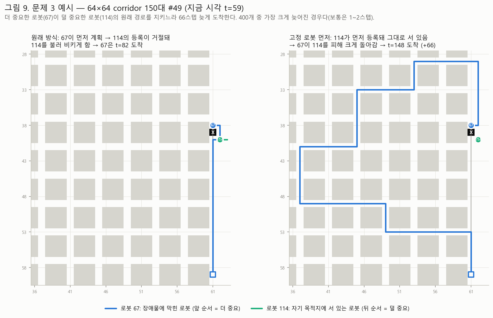

# 19. 문제 3 설계 — 크게 돌아가게 됐으면 "비켜 줘"를 한 번 시도해 보기

> 작성: 2026-11-17. 15장의 **문제 3**(고정 먼저 방식에서 다시 계획한 로봇이 서 있는 로봇을 피해 크게 돌아감)을
> 17장(작업 시간)에 맞게 다시 정의하고 고친다. 16·17·18장을 읽었다고 가정한다.

---

## 19.0 한 장 요약

| 질문 | 답 |
|---|---|
| 무엇이 문제인가? | 고정 먼저 방식에서는 서 있는 로봇의 옛 경로를 먼저 적는다. 그래서 다시 계획하는 로봇 W는 길이 **있기만 하면**, 아무리 멀어도 그 로봇을 피해 돌아간다. "비켜 줘"는 W의 A\*가 **실패할 때만** 한다(15장 그림 9: +66스텝) |
| 다시 정의 (17장) | **작업 중**인 로봇을 피해 돌아가는 건 올바른 동작이다. 문제는 **"비켜 주는 게 더 싼데도 안 물어본 것"**이다 |
| 해결 | 재계획이 성공한 뒤, W가 **가장 빠른 길보다 늦게** 도착하게 됐으면, W의 가장 짧은 길 위에 **서 있는 로봇**에게 "비켜 줘"를 넣어 **한 번 더** 계획해 본다. **로봇들이 목적지 밖에 있는 시간의 합**이 줄어들 때만 그 결과를 쓴다 |
| 작업 중인 로봇은? | 후보가 될 수 있다. 다만 17장 결정 4대로 **작업이 끝난 뒤에만** 비킨다. 그게 더 비싸면 결과를 안 쓴다 |
| 결과가 바뀌나? | 스위치(`ReplanConfig::request_yield`)를 켰을 때만. 기본은 꺼짐 → 지금과 완전히 같다 |

---

## 19.1 문제 다시 보기

### 그림 9 (15장)



로봇 67 앞에 장애물이 생겼다. 가장 짧은 우회로에는 로봇 114가 자기 목적지에 서 있다.

| 방식 | 일어나는 일 | 67 도착 |
|---|---|---|
| 원래 방식 | 67이 먼저 계획해서 114 자리를 지나감 → 114 등록 거절 → 114를 불러 비키게 함 | t82 |
| 고정 먼저 | 114의 옛 경로(계속 서 있음)가 먼저 적혀 있음 → 67의 A\*는 크게 돌아가는 길을 **찾아냄**(성공) → 비켜 달라고 할 기회가 없음 | **t148** |

고정 먼저에서 "비켜 줘"는 **A\*가 실패할 때만** 일어난다. 먼 길이라도 있으면 성공이라 아무도 부르지 않는다.

### 17장 이후의 정의

114가 **작업 중**이라면 67이 돌아가는 게 맞다(작업 중에는 안 움직이니까). 114가 **주차 중**이라면 비켜 달라고
하는 게 낫다. 그리고 17장 결정 4에 따라, 작업 중이어도 **작업이 곧 끝나면** "끝나면 비켜 줘"가 더 나을 수 있다.

그래서 문제 3은 이렇게 다시 정의한다.

> **"서 있는 로봇에게 비켜 달라고 하는 게 전체적으로 더 싼데도, 물어보지 않고 크게 돌아간 것."**

---

## 19.2 해결 — 성공한 뒤에 한 번 더 물어보기

재계획이 (어느 Tier에서든) **성공한 뒤에** 한 단계를 더한다.

```
1. 다시 계획한 로봇 중 "이동 중"이던 로봇 W마다:
     가장 빠른 도착 = 지금 + (벽·장애물만 보고 BFS로 잰 거리)        ← 로봇이 하나도 없을 때
     실제 도착     = W의 새 경로에서 목적지 도착 시각
     실제 > 가장 빠른 → W는 누군가 때문에 늦어졌다
         → W의 가장 짧은 길(쉬지 않고 가는 일정) 위에서 부딪히는 로봇 중
           "서 있는"(주차 중 또는 작업 중) 고정 로봇을 후보로 모은다
2. 후보가 없으면 끝.
3. 후보들을 재계획 로봇 명단 뒤에 붙여서 한 번 더 계획한다(try_replan_set 한 번).
4. 성공했고, "로봇들이 목적지 밖에 있는 시간의 합"이 줄었으면 → 그 결과를 쓴다.
   아니면 → 원래 결과를 그대로 쓴다.
```

### 왜 이렇게 정했나

| 결정 | 이유 |
|---|---|
| **성공한 뒤에만** 한다 | 실패할 때는 이미 Tier가 구조 로봇을 부른다. 문제 3은 "성공했지만 비싼" 경우다 |
| 후보는 **W의 가장 짧은 길 위**의 로봇 | 13장 아이디어 3(구조 후보 고르기)과 같은 계산(`shortest_path_conflicts`)을 그대로 쓴다. 새 규칙을 만들지 않는다 |
| **서 있는** 로봇만 | 움직이는 로봇은 기다리면 지나간다. 서 있는 로봇(Tail)만 "영원히" 막는다 |
| **작업 중**인 로봇도 후보 | 17장 결정 4: 불려도 작업이 끝난 뒤에만 비킨다. 작업이 곧 끝나면 기다리는 게 돌아가는 것보다 쌀 수 있다. 비싸면 4단계에서 걸러진다 |
| **한 번만** 더 시도 | 계산 시간을 정해 둔다. 여러 번 반복하면 Tier처럼 커진다 |
| 판단 기준: **목적지 밖에 있는 시간의 합** | 아래 설명 |

### 판단 기준: "로봇들이 목적지 밖에 있는 시간의 합"

지금 시각부터, 각 로봇이 **자기 목적지가 아닌 칸에 있는 스텝 수**를 모두 더한 값이다.

- 아직 가는 중인 로봇: 도착할 때까지의 시간(= 도착 시각 − 지금)
- 비켜 준 로봇: **비켜 있던 스텝 수**(예: 옆 칸에 1스텝 있다가 돌아오면 1)

왜 "경로 비용 합(도착 시각의 합)"을 안 쓰나? 비켜 준 로봇은 경로가 **돌아온 시각**에 끝난다. 예를 들어 t0에 도착해
있던 로봇이 t60에 1스텝 비켰다가 t61에 돌아오면, 도착 시각이 0 → 61로 바뀌어 비용이 61이나 늘어난 것처럼 보인다.
실제로 손해 본 건 1스텝뿐인데도. 그래서 **실제로 목적지 밖에 있던 시간**으로 잰다.

---

## 19.3 예시

```
         x:  0 1 2 3 4 5 6
  y=0:       . . . . . . .      ← 먼 길(윗줄)
  y=1:       . # # # # # .
  y=2:       W . . X . . G      ← W: (0,2) → G (6,2). t1에 (3,2)에 장애물 X
  y=3:       # # . P . # #      ← 짧은 길(아랫줄 가운데). P가 (3,3)에 서 있음
  y=4:       # # # . # # #      ← (3,4): P가 비켜설 수 있는 칸
```

- W(1순위): 옛 경로는 가운데 줄 직진. t1에 (1,2)에 있을 때 (3,2)에 장애물이 생긴다.
- P(2순위): (3,3)이 목적지, 처음부터 서 있다(장애물과 무관 → 고정 로봇).

| | W의 길 | W 도착 | P | 목적지 밖 시간의 합 |
|---|---|---|---|---|
| 고정 먼저 (스위치 끔) | 윗줄로 크게 돌아감: (1,2)→(0,2)→(0,1)→(0,0)→…→(6,0)→(6,1)→(6,2) | **t12** | 그대로 | W 11 + P 0 = **11** |
| 고정 먼저 + 비켜 줘 | 아랫줄 짧은 길: (2,2)→(2,3)→(3,3)→(4,3)→(4,2)→… | **t8** | (3,4)로 비켰다 돌아옴 | W 7 + P 1 = **8** → 줄었으니 씀 |

- **가장 빠른 도착**: 지금(1) + BFS 거리 7 = **8**. 실제 도착 12 > 8이라 1단계에 걸린다.
- **후보**: 가장 짧은 길(아랫줄)을 쉬지 않고 가면 t4에 (3,3)에서 P와 부딪힌다 → P가 후보(서 있음).
- **한 번 더 계획**: 명단 [W, P]. W가 먼저 짧은 길을 찾고, P는 W 뒤에 계획되어 W가 지나갈 때 (3,4)로 비켰다 돌아온다.
- **판단**: 11 → 8로 줄었다 → 쓴다.

### P가 작업 중이라면

| P의 작업 | 비켜 줘를 넣으면 | 판단 |
|---|---|---|
| t3에 끝남 | P는 t3까지 작업, t4에 비킴. W는 t4에 (3,3)을 지나 t8 도착 | 주차 중과 같음 → **씀** |
| t20에 끝남 | W는 t21 이후에야 (3,3)을 지남 → 크게 돌아가는 것(t12)보다 늦음 | 합이 늘어남 → **안 씀**, W는 윗줄로 돌아감 |

→ 작업 중인 로봇은 **작업이 곧 끝날 때만** 기다리는 쪽을 고르고, 오래 걸리면 돌아간다. A\*와 판단 기준이 알아서 고른다.

---

## 19.4 바뀌는 곳

| 파일 | 바뀌는 것 |
|---|---|
| `core/include/mapf/prioritized_planner.hpp` | `ReplanConfig::request_yield`(기본 false), `ReplanResult::yielded_ids`(비켜 달라고 해서 결과에 쓰인 로봇), 내부 함수 `try_yield_requests` |
| `core/src/prioritized_planner.cpp` | `replan`의 성공 직후 `try_yield_requests` 호출(스위치를 켰을 때만). 판단 기준 계산 |
| `tools/benchmark.cpp` | `--yield` 옵션, `selective_yielded` 열 |

---

## 19.5 확인 방법

### 테스트

| 테스트 | 확인하는 것 |
|---|---|
| 주차 중인 로봇이 비켜 줌 | 19.3 예시: 스위치를 끄면 W t12, 켜면 W t8 + P가 1스텝 비켰다 돌아옴, `yielded_ids == {P}` |
| 작업이 곧 끝나는 로봇 | P 작업이 t3에 끝나면 → 비켜 줌, W t8 |
| 작업이 오래 걸리는 로봇 | P 작업이 t20에 끝나면 → 결과를 안 씀, W t12, `yielded_ids` 비어 있음 |
| 스위치를 끄면 그대로 | 기존 테스트 78개 + 벤치마크 결과가 2-2와 칸마다 같음 |

### 벤치마크

고정 먼저 + 아이디어 3에 `--yield`를 켜고 끈 결과를 같은 시나리오로 비교한다: 경로 비용 합, 바뀐 로봇 수, 비켜 준
로봇 수, 시간. 15장에서 문제 3은 영향받은 로봇의 4%에서 생겼고 최악 +66스텝이었다(예전 엔진 기준). 이번엔 지금
엔진(동점 규칙 고정)으로 다시 잰다.

---

## 19.6 스스로 확인하는 질문

1. 고정 먼저 방식에서 "비켜 줘"가 A\*가 실패할 때만 일어나는 이유는?
2. 17장 이후 문제 3을 "작업 중인 로봇을 피해 돌아가는 것"으로 정의하지 않는 이유는?
3. 판단 기준으로 "경로 비용 합"이 아니라 "목적지 밖에 있는 시간의 합"을 쓰는 이유는?
4. 19.3 예시에서 P의 작업이 t20에 끝나면 왜 비켜 달라고 하지 않나?
5. 움직이는 로봇은 왜 후보에서 빼나?

<details>
<summary>답 보기</summary>

1. 서 있는 로봇의 옛 경로가 먼저 장부에 적혀 있어서, W의 A\*는 그 로봇을 피하는 길을 찾는다. 먼 길이라도 있으면 성공이고, 구조 로봇은 실패했을 때만 부르기 때문이다.
2. 작업 중인 로봇은 어차피 작업이 끝날 때까지 못 움직이니, 그동안 돌아가는 건 올바른 동작이다. 문제는 비켜 주는 게 더 싼데도 물어보지 않은 경우다.
3. 비켜 준 로봇의 경로는 돌아온 시각에 끝나서, 1스텝만 비켜도 도착 시각이 크게 늘어난 것처럼 보이기 때문이다. 실제 손해(목적지 밖에 있던 시간)로 재야 공정하다.
4. P가 t20까지 못 움직이니 W는 t21 이후에야 지나갈 수 있다. 그러면 윗줄로 돌아가는 것(t12)보다 늦어서 합이 늘어나므로 결과를 쓰지 않는다.
5. 움직이는 로봇은 W가 잠깐 기다리면 지나간다. "영원히" 막는 건 서 있는 로봇(Tail)뿐이다.

</details>

---

## 19.7 구현 결과 (2026-11-17)

### 한 것

- `ReplanConfig::request_yield`(기본 false), `ReplanConfig::yield_min_delay`(기본 1: 조금이라도 늦으면 시도),
  `ReplanResult::yielded_ids`, 내부 함수 `try_yield_requests`. 파이썬 바인딩에 `yielded_ids` 노출.
- 벤치마크: `--yield`, `--yield-min-delay N`, 열 `selective_yielded`, 그리고 **목적지 밖에 있는 시간의 합** 열
  `full_replan_away`, `selective_away`(전체 재계획과 우리 방법을 같은 기준으로 비교할 수 있게).
- 테스트 2개 추가 → **80개 통과**. 19.3 예시의 손 계산이 그대로 나왔다(끄면 W t12, 켜면 t8. P가 작업 중이면 t3에
  끝날 때는 비켜 주고, t20에 끝날 때는 안 씀). 판단 기준("합이 줄 때만 씀")을 일부러 빼면 작업이 오래 걸리는
  경우의 테스트가 실패한다.
- **스위치를 끄면 2-2와 칸마다 같다**(원래 방식, 고정 먼저 + 아이디어 3의 32×32·64×64 확인).

### 효과: 있지만 작다

같은 시나리오에서 스위치를 끈 것과 켠 것을 비교했다(고정 먼저 + 아이디어 3).

| | 32×32 | 64×64 |
|---|---|---|
| 비켜 줘를 쓴 시나리오 | 4 / 400 | 28 / 400 (7%) |
| 쓴 시나리오에서 줄어든 목적지 밖 시간 | 중앙값 2.5, 최대 7 | 중앙값 3.5, 최대 23 |
| 전체 목적지 밖 시간 합 | −13 (94,742 중) | −163 (1,168,419 중) |
| 성공 수 | 400 → 400 | 399 → 399 |

같은 시나리오에서 **경로 비용 합은 오히려 늘어 보인다**(64×64 중앙값 +27.5, 최대 +217). 비켜 준 로봇의 경로가 돌아온
시각에 끝나서 도착 시각이 늦게 찍히기 때문이다(19.2). 그래서 이 기능은 경로 비용 합이 아니라 목적지 밖 시간으로 봐야 한다.

### 시간과 문턱

| 64×64 | 쓴 시나리오 | 목적지 밖 시간 합 변화 | 재계획 시간 합계 |
|---|---|---|---|
| 끔 | – | – | 17.6초 |
| 켬, 문턱 1 | 28 | −163 | 21.1초 (+20%) |
| 켬, 문턱 5 | 20 | −143 | 20.3초 |
| 켬, 문턱 10 | 14 | −138 | 19.1초 (+9%) |
| 켬, 문턱 20 | 5 | −57 | 18.3초 (+4%) |

시간이 느는 이유는 "늦어진 로봇이 있으면 일단 한 번 더 계획"해 보고, 쓰지 못하고 버리는 시도가 많기 때문이다.
**문턱 10**이면 효과의 약 85%를 지키면서 시간 증가가 절반 아래로 준다. 켤 때는 문턱 10을 권한다.

### 판단

- 지금 엔진(동점 규칙 고정, 18장)에서 **문제 3은 생각보다 작다.** 15장의 "최악 +66스텝"은 예전 엔진에서 잰 것이고,
  지금은 쓴 시나리오에서 최대 23~25스텝, 64×64 시나리오의 7%에서만 생긴다.
- 그래서 **기본은 끈 채로 두고**, 논문에서는 "양보 요청" 부품의 효과를 보여 주는 비교표(ablation) 한 줄로 쓴다.
- 참고로 같은 시나리오의 목적지 밖 시간 합은 전체 재계획 1,147,710, 우리 방법 1,148,491(끔)·1,148,343(켬)으로
  **거의 같다**(0.07% 차이). 전체 재계획은 모든 로봇을 다시 계획하므로 이 지표에서는 약간 유리하다.

### 문제 2(헛부탁)는 지금 엔진에서 거의 없다

"다시 계획한 로봇 수 − 바뀐 로봇 수"로 어림하면, 구조 로봇을 부른 시나리오에서 64×64는 122대 중 2대(2%),
32×32는 11대 중 0대다. 15장의 5~19%는 예전 엔진(동점은 아무거나) 때 잰 것이다. **따로 고치지 않는다.**

