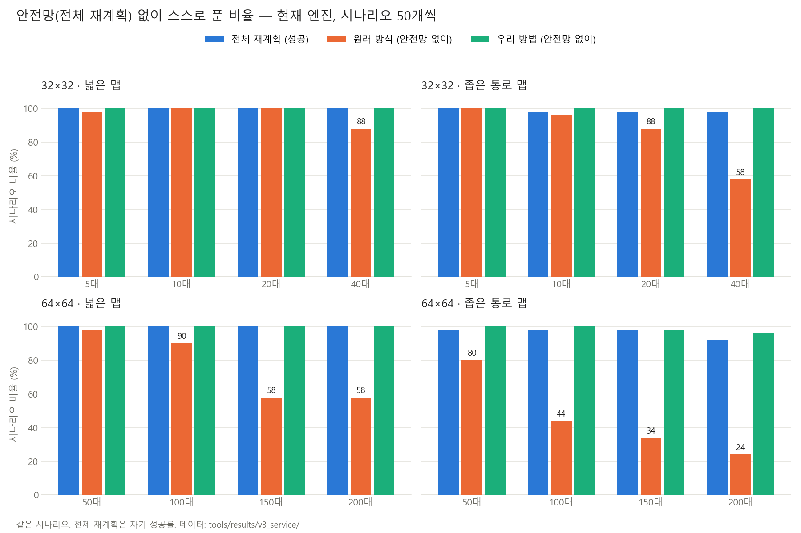
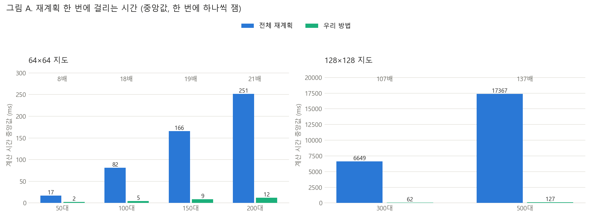
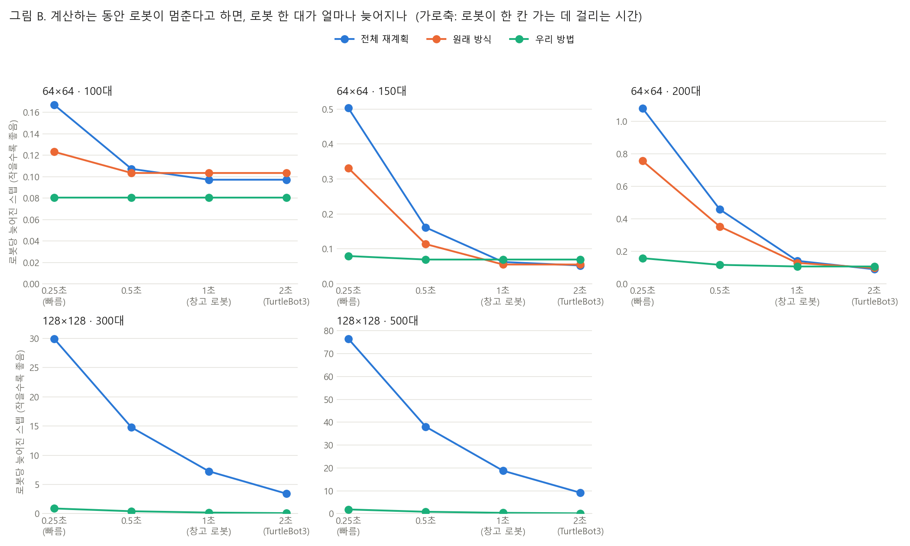
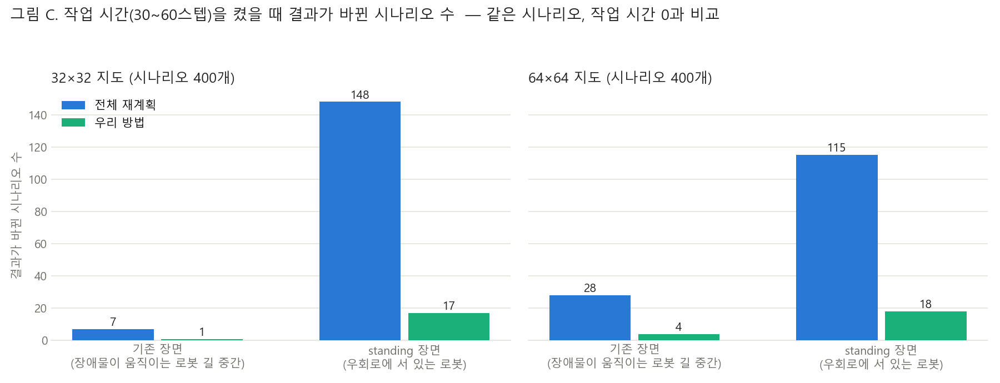

# 25. 실험 결과 쉬운 요약 — 무엇을 했고, 어떤 그림을 보면 되나

> 2026-11-18. 21~24장의 실험을 처음 보는 사람도 따라올 수 있게 정리한다. 자세한 숫자와 방법은 23장.

---

## 25.0 세 줄 요약

1. **성공률**: 우리 방법은 전체 재계획보다 **절대 낮지 않고**, 99% 이상을 안전망 없이 스스로 푼다(그림 0).
2. **속도**: 재계획이 64×64에서 **8~21배**, 128×128에서 **107~137배** 빠르다(그림 A). 64×64에서는 **빠른 로봇이 많을 때**만
   실제 손해 차이가 컸지만, 128×128에서는 느린 로봇에서도 차이가 크다(그림 B, 25.4).
3. **작업 시간**: "돌아가는 길목에 서 있는 로봇"이 있는 장면에서 작업 시간이 결과를 바꾼다. 전체 재계획은 크게 흔들리고 우리 방법은 적게 흔들린다(그림 C).

---

## 25.1 무슨 실험을 했나

모든 실험의 기본 장면은 같다: 로봇 여러 대가 계획대로 움직이다가, **갑자기 장애물(1~3칸)이 나타나** 누군가의 길을 막는다.
그때 **두 방법으로 다시 계획**해서 비교한다.

- **전체 재계획**: 모든 로봇을 지금 위치에서 처음부터 다시 계획한다(비교 기준).
- **우리 방법**: 막힌 로봇만 다시 계획한다. 고정 로봇을 먼저 적고(①), 길이 아예 없으면 바로 포기하고(②), 막히면 길 위의 로봇만 불러 비키게 한다(③).
  그래도 안 되면 전체 재계획(안전망).

| 실험 | 묻는 질문 | 어떻게 | 결과 그림 |
|---|---|---|---|
| 성공률 | 우리 방법이 더 자주 실패하지 않나? | 같은 시나리오 400개씩, 안전망 없이 푼 비율 | 그림 0 |
| 계산 시간 | 얼마나 빠른가? | 한 번에 하나씩 돌려 깨끗하게 잰 시간 | 그림 A |
| ① 계산 시간 → 손해 | 빠른 게 실제로 로봇에게 이득인가? | 계산하는 동안 **모든 로봇이 멈춘다**고 두고, 로봇이 얼마나 늦어지는지 | 그림 B |
| ② 작업 시간 장면 | 작업 시간을 넣은 게 의미가 있나? | 돌아가는 길목에 **이미 도착해 서 있는 로봇**이 있는 장면을 만들고, 작업 시간을 켜고 끄며 비교 | 그림 C |

---

## 25.2 봐야 할 그림 (이 순서로)

### 그림 0 — 성공률: `tools/plots_study/success_v3.png`

- **읽는 법**: 막대가 높을수록 좋다. 파랑 = 전체 재계획의 성공률, 주황 = 원래 방식이 안전망 없이 푼 비율, 초록 = 우리 방법이 안전망 없이 푼 비율.
- **볼 것**: 초록이 모든 칸에서 파랑과 같거나 높다. 주황은 로봇이 많고 통로가 좁을수록 크게 떨어진다(64×64 통로 200대: 24%).
- **결론**: 우리 방법은 "결국 전체 재계획을 돌리는 것"이 아니다. 거의 항상 스스로 푼다.

### 그림 A — 계산 시간: `tools/plots_study/v4_1_compute_time.png`

- **읽는 법**: 막대가 낮을수록 빠르다. 위의 "○배"가 몇 배 빠른지.
- **볼 것**: 로봇이 많을수록 배수가 커진다(50대 8배 → 200대 21배).
- **주의**: 예전에 보여 드린 시간(200대 0.64초)은 여러 시나리오를 동시에 돌려서 서로 방해받은 값이었다. 이 그림이 정확한 값이다(0.25초).

### 그림 B — 계산 시간을 손해로 바꾸면: `tools/plots_study/v4_2_latency_loss.png`

- **읽는 법**: 세로축 = 로봇 한 대가 평균 몇 스텝 늦어졌나(낮을수록 좋음). 가로축 = 로봇이 한 칸 가는 데 걸리는 시간(왼쪽이 빠른 로봇).
  늦어짐 = "다시 짠 경로 때문에 늦어진 것" + "계산 끝날 때까지 멈춰 있던 것".
- **볼 것**: 왼쪽(빠른 로봇)에서는 파랑(전체 재계획)이 크게 높고 초록(우리)은 낮다. 오른쪽(느린 로봇)으로 갈수록 세 선이 모인다.
- **결론**: 200대, 한 칸 0.25초면 로봇당 늦어짐 **1.08 → 0.16 스텝**. 한 칸 1초 이상이면 차이가 거의 없다.

### 그림 C — 작업 시간이 결과를 바꾸나: `tools/plots_study/v4_3_standing.png`

- **읽는 법**: 작업 시간을 0에서 30~60스텝으로 바꿨을 때, 같은 시나리오인데 결과가 달라진 개수(400개 중).
- **볼 것**: 기존 장면에서는 거의 안 바뀐다(7개, 28개). standing 장면에서는 전체 재계획이 크게 바뀐다(148개, 115개). 우리 방법은 적게 바뀐다(17개, 18개).
- **결론**: 작업 시간을 모델에 넣는 게 의미 있는 장면이 있다. 전체 재계획은 서 있는 로봇까지 전부 다시 계획하므로 "작업 중이라 못 움직임"에
  크게 영향받는다. 우리 방법은 서 있는 로봇을 거의 안 건드려서 덜 흔들린다. 대신 흔들릴 때는(작업 중인 로봇이 정말 길을 막을 때) 비켜 줄 수 없어서
  꽤 늦어진다(목적지 밖 시간 평균 +23~38스텝) — 현실에서 피할 수 없는 비용이다.

---

## 25.3 왜 "빠른 로봇"일수록 계산 시간이 손해인가

**계산 시간은 초(秒)로 걸리는데, 손해는 스텝(칸)으로 센다.** 같은 1초라도 로봇이 빠르면 그 1초 동안 갈 수 있었던 칸이 많다.

예: 전체 재계획이 **1초** 걸렸다고 하자. 그동안 로봇은 새 계획을 기다리며 멈춰 있다.

| 로봇 | 한 칸에 걸리는 시간 | 1초 동안 원래 갈 수 있던 칸 | 멈춰서 잃은 스텝 |
|---|---|---|---|
| 빠른 로봇 | 0.25초 | 4칸 | **3스텝**(첫 0.25초 안에 끝났으면 0) |
| 창고 로봇 | 1초 | 1칸 | **0스텝**(다음 칸 가기 전에 계산이 끝남) |
| TurtleBot3 | 2초 | 0.5칸 | **0스텝** |

그리고 손해는 **기다린 로봇 수만큼 곱해진다**. 200대가 3스텝씩 기다리면 600스텝이다.

비유: 내비게이션이 길을 다시 찾는 데 3초 걸린다면, 걷는 사람에게는 몇 걸음이라 상관없지만, 고속도로를 달리는 차에게는 그 3초 동안
출구를 지나쳐 버릴 수 있다. 그래서 **빠르고 많은 로봇**일수록 "빨리 다시 계획하는 것"이 중요해진다.

우리 방법은 대부분 0.01초 안팎이라 빠른 로봇에서도 거의 안 멈춘다. 전체 재계획은 200대에서 가끔 1초를 넘어(느린 5%가 1.1초) 빠른 로봇을 멈추게 한다.

---

## 25.4 더 큰 규모(128×128)

로봇 300·500대, 시나리오 각 40개(2026-11-18, `tools/results/v4_latency/ours_huge_t1thread.csv`, 한 번에 하나씩 잼).
1,000대는 전체 재계획 한 번이 수십 초 이상 걸리고 처음 계획부터 자주 실패해서 이번에는 뺐다.

| | 300대 | 500대 |
|---|---|---|
| 전체 재계획 시간(중앙값) | **6.6초** (느린 5%: 20초) | **17.4초** (느린 5%: 49초) |
| 우리 방법 시간(중앙값) | 0.06초 | 0.13초 |
| 몇 배 빠른가 | **107배** | **137배** |
| 성공(둘 다) | 40/40 | 40/40 |
| 우리 방법이 안전망 없이 푼 수 | 40/40 | 39/40 (1개만 안전망) |
| 처음 배치를 버린 비율 | 13% | 66% |

**로봇당 늦어진 스텝**(그림 B 아래 줄, 경로 손해 + 계산 동안 멈춤):

| 한 칸 이동 시간 | 300대: 전체 → 우리 | 500대: 전체 → 우리 |
|---|---|---|
| 0.25초(빠름) | 29.9 → 0.9 | 76.5 → 1.9 |
| 0.5초 | 14.8 → 0.4 | 38.1 → 0.9 |
| 1초(창고 로봇) | 7.3 → 0.2 | 18.8 → 0.4 |
| 2초(TurtleBot3) | 3.4 → 0.1 | 9.2 → 0.2 |

**쉬운 해석**: 64×64까지는 "빠른 로봇일 때만" 차이가 났다. 128×128에서는 전체 재계획이 **몇 초~수십 초** 걸리기 때문에,
느린 로봇(한 칸 2초)도 그동안 몇 칸씩 멈춰 있게 된다. 그래서 **규모가 커지면 로봇 속도와 상관없이** 우리 방법의 이득이 크다.
(주의: 시나리오가 40개라 64×64보다 적다. 처음 배치를 66% 버렸으므로 "처음 계획이 가능한 배치"에서의 결과다.)

---

## 25.5 정리: 논문에서 말할 수 있는 것 / 조심할 것

- ✅ 성공률은 전체 재계획 이상(구조적 보장 + 데이터).
- ✅ 8~21배 빠르고, 로봇이 많을수록 차이가 커진다.
- ✅ 빠른 로봇이 많은 현장에서는 이 속도가 실제 늦어짐 차이로 이어진다.
- ⚠ 64×64 이하에서 한 칸 1초 이상인 느린 로봇·적은 로봇 수에서는 실제 이득이 거의 없다 — 숨기지 말고 조건으로 적는다.
- ✅ 128×128(300~500대)에서는 느린 로봇에서도 이득이 크다(전체 재계획이 수 초~수십 초).
- ⚠ 로봇이 많을수록 처음 배치를 많이 버린다(64×64 200대 62%, 128×128 500대 66%) — "처음 계획이 가능한 배치"만 쓴다고 적는다.
  지금 `plan_attempts` 열은 "처음 계획 실패"와 "장애물이 아무도 안 막음"을 섞어 센다 → 이유별 열로 나누는 작업 남음.
- ✅ 작업 시간을 넣으면 결과가 달라지는 장면이 있고, 우리 방법은 그 영향을 덜 받는다.
